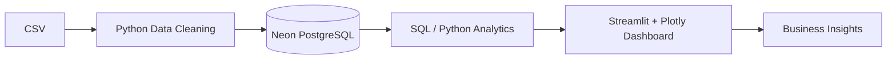

# Customer Intelligence | Shopping Behavior & Business Insights

A customer analytics project: a Python cleaning notebook, a **Neon PostgreSQL** database, SQL business queries, and an interactive **Streamlit + Plotly** dashboard over 3,900 customer shopping records.

## Business problem

A retailer wants to know **who its customers are, what they buy, how they pay, and where discounts and subscriptions fit in**, so marketing, merchandising and logistics teams can prioritise effort. The dashboard answers questions such as:

- Which customer segments, age groups and locations contribute most purchase amount?
- Which categories and products are most popular, best rated, or most discount-dependent?
- Do subscribers spend differently from non-subscribers?
- Which shipping and payment options do customers actually use?

## Dataset and limitations

| Item | Detail |
|---|---|
| Source file | `data_source/customer_shopping_behavior.csv` (3,900 records, 18 raw columns) |
| Database table | `customer` in Neon PostgreSQL |
| Key fields | customer_id, age, gender, item_purchased, category, purchase_amount (USD), location, season, review_rating, subscription_status, shipping_type, discount_applied, previous_purchases, payment_method, frequency_of_purchases |
| Derived fields | `age_group`, `purchase_frequency_days` |

**Limitations (the dashboard respects all of these):**

- **No transaction date or timestamp** - there are no time trends, seasonality-over-time or period comparisons. `season` is a product attribute, not a purchase date.
- `purchase_amount` is the recorded amount in USD; margins, costs and pre-discount prices are not available.
- Rows are *records*; the dashboard checks customer-ID uniqueness and reports records and unique customers separately.
- Findings are **observational associations**, not causal claims (e.g. discounts are not shown to *cause* higher spend).
- `discount_applied` and `promo_code_used` were identical, so promo codes are not analysed separately.

## Data cleaning and feature engineering

Done once in `notebooks/Customer_Shopping_Behavior_Analysis.ipynb` (the dashboard does **not** repeat it):

1. Load the CSV and profile it (`info`, `describe`, null counts).
2. Fill 37 missing `Review Rating` values with the **median rating of the product category**.
3. Standardise column names (lower-case, snake_case; `purchase_amount_(usd)` -> `purchase_amount`).
4. `age_group`: age quartiles labelled Young Adult / Adult / Middle-aged / Senior (`pd.qcut`, so groups are similar in size by design).
5. `purchase_frequency_days`: maps the frequency label (Weekly = 7, Fortnightly/Bi-Weekly = 14, Monthly = 30, Quarterly/Every 3 Months = 90, Annually = 365).
6. Drop `promo_code_used` (identical to `discount_applied`).
7. Write the cleaned table to Neon as `customer`.

## Architecture



- **Neon PostgreSQL is the single source of truth.** The dashboard never reads the CSV; the CSV is only the input of the cleaning notebook.
- **Read-only access:** the dashboard only runs `SELECT`s, and every session is opened with `default_transaction_read_only=on`, so the server itself rejects writes.
- Credentials come from `DATABASE_URL` (`.env`, via `python-dotenv`); they are never hardcoded, logged or shown in the UI.
- Data is loaded once, cached (`st.cache_data`, 1 hour) and filtered in-memory with pandas, so filter changes are instant. A **Refresh data from database** button clears the cache.

Data flow: `database` (engine, SELECTs) -> `analytics.data_loader` (validate, add segment) -> cached in `app.py` -> sidebar filters -> `dashboard/*` tabs, which call `analytics.metrics` / `analytics.insights` for numbers and `components.charts` for figures.

### Project structure

```text
app.py                        Entry point: page setup, cached data loading, filters, tabs
dashboard/                    One module per tab (render functions) + styles
  styles.py                   CSS, hero banner, "key finding" box
  overview.py  demographics.py  products.py  subscriptions.py
  discounts.py purchasing.py    insights.py  data_quality.py
analytics/                    No Streamlit/Plotly/database code
  data_loader.py              Validation, data-quality report, customer segment
  metrics.py                  KPIs and aggregations
  insights.py                 Dynamic business insights
components/                   Reusable UI pieces
  charts.py                   Plotly figure builders
  filters.py                  Sidebar filters and filtering logic
  kpi_cards.py                KPI cards and number formatting
database/
  connection.py               Read-only engine, safe error messages
  queries.py                  The only SQL the app runs (SELECTs)
config/settings.py            Expected schema, segment rule, filters, thresholds
tests/                        pytest: analytics, database, dashboard
sql/customer_behavior_sql_queries.sql         10 SQL business questions
notebooks/Customer_Shopping_Behavior_Analysis.ipynb   Cleaning + upload to Neon
data_source/customer_shopping_behavior.csv    Raw data (notebook input only)
```

## SQL analysis

[`sql/customer_behavior_sql_queries.sql`](sql/customer_behavior_sql_queries.sql) answers 10 business questions directly in PostgreSQL: revenue by gender, high-spending discount users, top-rated products, shipping comparison, subscriber value, discount-heavy products, customer segmentation, top products per category (window functions), repeat buyers vs subscription, and revenue by age group. The dashboard's KPIs and group summaries can be reconciled against these queries.

## Interactive dashboard

Eight tabs, all driven by the sidebar filters:

| Tab | What it answers |
|---|---|
| Executive Overview | 8 KPIs (total purchase amount, records, unique customers, average per record, age, rating, subscription rate, discount rate) with explanations and "All data" comparison |
| Customer Demographics | Gender, age group, location distribution and spend |
| Product & Category | Category contribution (treemap with drill-down), dynamic product ranking, popularity vs rating, rating distributions |
| Subscription & Segments | Subscribers vs non-subscribers, previous-purchase segments, documented segmentation rules |
| Discounts | Usage, spend comparison, discount dependence by category/product |
| Shipping & Payment | Shipping and payment preferences, purchase frequency, payment x shipping heatmap |
| Insights & Recommendations | Seven insights computed from the filtered data, each with finding, metric, why it matters, recommendation and caveat |
| Data Quality | Row reconciliation with `COUNT(*)`, missing values, duplicates, unexpected labels |

**Filters:** gender, age group, category, product, season, subscription, shipping, discount, payment method, purchase frequency and location (plus a reset button). Empty selections mean "all"; empty results show a clear message instead of errors.

**Segmentation rule** (defined once in `config/settings.py`, same thresholds in SQL Q7): *New* = 0-1 previous purchases, *Returning* = 2-10, *Loyal* = more than 10. "New" means a **short recorded history**, not necessarily a first-time buyer.

**Analytical safeguards:** schema validation, duplicate/ID checks, safe division, group-level denominators for rates, minimum group sizes before ranking, and insights suppressed when data is insufficient.

## Run locally

Requires Python 3.10+ and a Neon database containing the `customer` table.

```bash
git clone <your-repo-url>
cd Customer-Trend-Data-Analysis

python3 -m venv .venv
source .venv/bin/activate            # Windows: .venv\Scripts\activate
pip install -r requirements.txt

cp .env.example .env                 # then edit .env and set DATABASE_URL
streamlit run app.py
```

Run the tests (no database or network needed; they use synthetic data and in-memory SQLite):

```bash
python -m pytest -q
```

`.env` is git-ignored. Never commit real credentials.

**Notebook:** open `notebooks/Customer_Shopping_Behavior_Analysis.ipynb` with Jupyter started in the `notebooks/` folder (paths to `../data_source/` and `../.env` are relative to it).

**Troubleshooting:** if you see "Database host could not be resolved" although the URL is correct, your local DNS may not resolve Neon hostnames. Set `DB_RESOLVER_DNS=1.1.1.1` in `.env`; the app then looks the host up through that DNS server and still verifies TLS against the real hostname.

> **Warning:** the notebook's last cell uploads with `if_exists="replace"`, which *replaces* the `customer` table. Only run it deliberately; the dashboard itself never writes.

## Screenshots

> Add screenshots to a `docs/screenshots/` folder and link them here.
